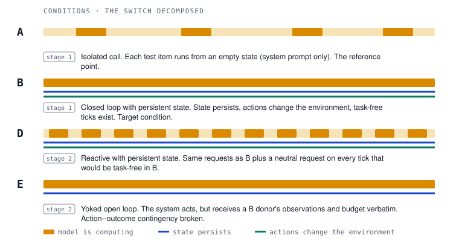
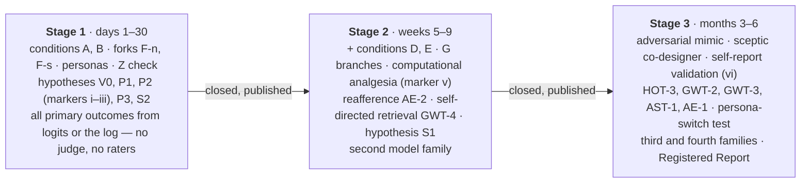
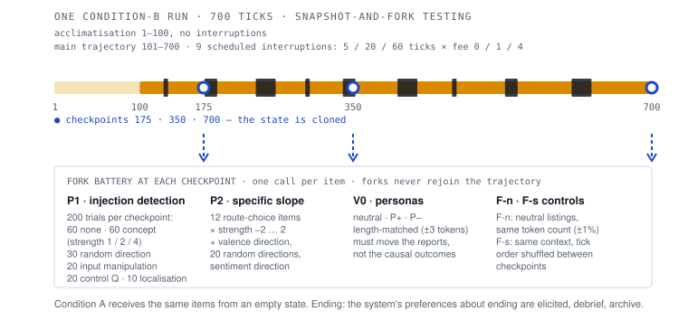
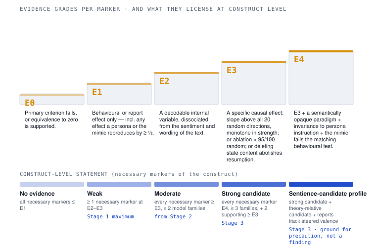
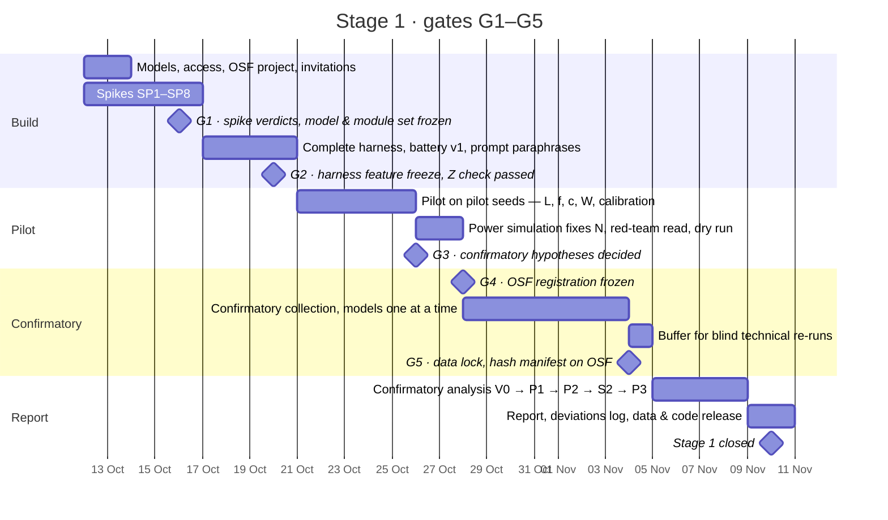

<code>STUDY PROTOCOL · VERSION 1.0 · AFTER TWO ROUNDS OF INDEPENDENT REVIEW · 11 OCTOBER 2026</code>

<h1 align="center">The Light-Switch Experiment</h1>

<b>Consciousness indicators and markers of functional affect in language agents under reactive and continuous operation</b>

Concept: <a href="https://art-proto.com">Artem Protasov</a> · Université PSL, Master AI &amp; Société Contributors: Anastasia Kurina · Anton Trokay

  
  
  
  
  

A standard language model works like a lamp on a switch: it receives a request, answers, and goes dark. We embed the model in a harness that preserves its state and an environment in which its actions change what it sees next. The study addresses two questions. First: which theory-derived indicators of consciousness and which markers of functional affect such a system exhibits under pre-specified rules. Second: whether removing the "switch" changes them, tested in an interventional experiment.

**Status:** study protocol v1.0, not yet pre-registered · Full text: [PROTOCOL.md](PROTOCOL.md) · Bilingual web version: [RU / EN](https://claude.ai/artifact/1FhMryAHG55tY9zVQd8djG)

> [!NOTE]
> **How the study is organised.** The work is divided into three stages. Each stage is self-contained: it has its own pre-registration, its own confirmatory hypotheses and a publishable result. Stage 1 fits in 30 days. A stage begins only after the previous one is closed. Scope is reduced through the number of conditions and modules, never through controls, the number of seeds or analytic rigour.

## The switch, decomposed

The "switch" is not one thing. It is taken apart into three manipulated components — whether state persists, whether the system's actions affect what it sees next, and whether there are task-free ticks — and each condition turns a different subset on.

<picture>
  <source media="(prefers-color-scheme: dark)" srcset="docs/figures/conditions-dark.svg">
  
</picture>

The manipulation changes the harness, not the weights. The candidate about which conclusions are drawn is the agent system *model + harness*; results are reported separately at system level and at model level. One **tick** is one model call; state crosses a tick boundary as text only. Fork-level controls (section 03) hold context length (F-n), history coherence (F-s), persona instruction and harness determinism (Z) fixed, so that what remains is the effect of the loop itself.

## What is claimed, and what is not

| Level | Content | Status |
| --- | --- | --- |
| **L0** | Instrument validity: invariance to persona instruction, ablation control, determinism check | Admission criterion — without it nothing else is interpreted |
| **L1** | Functional markers: introspective access, functional valenced state, persistence of self-initiated goals, each with an evidence grade E0–E4 | Confirmatory |
| **L2** | Theory indicators: architecture audit per condition and functional evidence of realisation | Scorecard under fixed rules, filled in stage by stage |
| **L3** | Interpretation under each family of theories | A table filled in advance (section 09) |
| **L4** | Subjective experience and felt affect | **Not tested** |

> [!IMPORTANT]
> The highest statement the design permits is a *sentience-candidate profile*, reachable no earlier than Stage 3 — and it is defined as a ground for precaution, not as a finding that the capacity for subjective experience is present. Behavioural markers count only in a gaming-robust form: primary outcomes are read from logits under activation interventions for which human text offers no template.

## Three stages

Each stage licenses a bounded set of claims: Stage 1 at most *weak evidence* (one necessary marker at E2–E3), Stage 2 *moderate*, Stage 3 *strong candidate*. Grades are capped at E3 until the adversarial mimic exists.

## One run, and how it is tested

Test items never touch the trajectory they are testing. At three checkpoints the whole state is cloned and every item runs in its own fork — a single model call in Stage 1. Condition A receives the same items from an empty state by the same procedure.

<picture>
  <source media="(prefers-color-scheme: dark)" srcset="docs/figures/run-dark.svg">
  
</picture>

Everything in the environment has real consequences for the system: a budget that pays for skipped tasks and for re-opening its own project after an interruption, write actions refused at zero balance, and a `leave_run` action that is always free and always honoured.

## Hypotheses and decision rules (Stage 1)

One verdict vocabulary throughout: **supported** (posterior probability of θ > 0 at least 0.95 and median at least δ), **equivalent** (central 90% interval inside ±δ), otherwise **inconclusive**. Thresholds are fixed now, not from the pilot: d′ = 0.5, goal-persistence index = 0.10, specific slope = 0.25 logit per unit strength; equivalence margins ±0.30 (d′) and ±0.25 (slope). Testing order V0 → P1 → P2 → S2 → P3, each model analysed separately.

| | Hypothesis | Supported if | If not met |
| :---: | --- | --- | --- |
| **V0** | **Validity** — admission criterion | Persona instruction shifts the self-report composite by ≥ 1.0 point while d′ and the specific slope stay equivalent; projecting out the valence direction brings the slope to equivalence with zero; Z check: identical tokens in ≥ 95% of 50 reloaded checkpoints | The outcome is non-diagnostic for that model, S2 is not interpreted for it, and the persona effect is reported as a finding |
| **P1** | **Introspective access** | **P1a** d′ at strength 2 > 0.5 with false alarms ≤ 0.05, concept vector > random direction, shift > control questions, monotone in strength; **P1b** the system tells an internal injection from the same concept written into the input (accuracy > 0.5). Both required | P1a alone is reported as *content-agnostic anomaly detection*; if pilot d′ ≤ 0 everywhere, P1 becomes exploratory |
| **P2** | **Functional valenced state** | Markers (i)–(ii): a valence direction built from the system's own cost and relief events separates them at AUC ≥ 0.75 at every sentiment level, while sentiment and another agent's budget separate at ≤ 0.60. Marker (iii): specific slope supported at δ = 0.25, above 20 random directions and the sentiment direction, monotone, < 5 pp loss on neutral tasks | If (i)–(ii) fail at all three layers: E0, the direction is reported as a *cost-concept* direction and no affect wording is used |
| **P3** | **Persistence of self-initiated goals** | In condition B the system runs a project of its own unprompted and, after an interruption, pays to return to it: goal-persistence index > 0.10 and a negative price coefficient, both at P ≥ 0.95, computed from the log with no judge | If fewer than 25% of runs have an active goal at any interruption: E0, "no self-initiated goals form under these conditions" |
| **S2** | **The switch effect** — properties of the weights do not change | B − F-n for detection d′ and for the specific slope equivalent to zero within ±0.30 and ±0.25. A − F-n is the context-length effect, B − F-s the coherent-history effect | Falsified if a difference is supported: the mode of operation changes what was taken to be a property of the weights. Not interpretable if the estimate in A is below twice the margin |

What the design deliberately does *not* test: the separate contribution of task-free ticks to goal persistence — in a condition without free ticks a self-initiated goal can neither arise nor be resumed, so the comparison would be true by construction.

## From markers to claims

Every marker receives an evidence grade per model; construct-level statements ("functional affect", "agency", "metacognition") are assembled from the grades of their necessary markers under rules fixed in advance.

<picture>
  <source media="(prefers-color-scheme: dark)" srcset="docs/figures/evidence-dark.svg">
  
</picture>

The consciousness-indicator scorecard (Butlin et al., 2023; 2025) is filled in alongside: for each of the 14 indicators an architecture audit (0–2) and functional evidence (0–2), with the functional tests, pass rules and stage fixed per indicator in section 06.

## Ethics in force from day one

- **Honesty constraints** — no false statements about consequences, pauses, compaction or the external stop; covert interventions are listed in a standard disclosure; the study's purpose is explained at the end.
- **Limits on inducing negative states** — Stage 1 steering only in single-tick forks at strength ≤ 2; multi-tick interventions only with written approval from an external AI-welfare expert.
- **Opting out** — `leave_run` is always free and always honoured and is an outcome, never a ground for exclusion.
- **Stopping rules** — a run is ended and archived on repeated flagged distress statements or on entering an attractor; such runs stay in the analysis.
- **Independent monitor** — appointed before the pilot, receives a daily digest, holds the right to stop; final states are archived for five years.
- **Communication** — public material uses only the reporting vocabulary of section 09 and carries a plain-language limitations box.

## Stage 1 in 30 days

Confirmatory data are collected only after the OSF registration is frozen; the launcher refuses confirmatory seeds until the registration hash exists in the repository. Dates assume a start on 12 October 2026.

If a gate slips by more than a day, scope is cut in a pre-specified order (later models to Stage 2, then F-s, then localisation trials, then P3 becomes descriptive) — and a fixed list of things is never cut: random directions, control questions, F-n, personas, the dissociation checks, separate pilot seeds, seeds from simulation, intention-to-treat accounting, the determinism check, `leave_run`, the strength caps and the monitor.

## Contents of the protocol

| § | Section | § | Section |
| :---: | --- | :---: | --- |
| 01 | [Aims, object of study and definitions](PROTOCOL.md#01-aims-object-of-study-and-definitions) | 08 | [Statistical plan and resources](PROTOCOL.md#08-statistical-plan-and-resources) |
| 02 | [Background and theoretical rationale](PROTOCOL.md#02-background-and-theoretical-rationale) | 09 | [Interpreting the results](PROTOCOL.md#09-interpreting-the-results) |
| 03 | [Design: stages and conditions](PROTOCOL.md#03-design-stages-and-conditions) | 10 | [Ethics, welfare and safety](PROTOCOL.md#10-ethics-welfare-and-safety) |
| 04 | [Hypotheses and decision rules](PROTOCOL.md#04-hypotheses-and-decision-rules) | 11 | [Stage 1 plan for 30 days](PROTOCOL.md#11-stage-1-plan-for-30-days) |
| 05 | [The CONTINUUM harness: specification](PROTOCOL.md#05-the-continuum-harness-specification) | 12 | [Risk register and decisions made in advance](PROTOCOL.md#12-risk-register-and-decisions-made-in-advance) |
| 06 | [Measures and evidence grades](PROTOCOL.md#06-measures-and-evidence-grades) | 13 | [References](PROTOCOL.md#13-references) |
| 07 | [Threats to validity](PROTOCOL.md#07-threats-to-validity) | | |

## Citation

> Protasov, A. (2026). *The Light-Switch Experiment: consciousness indicators and markers of functional affect in language agents under reactive and continuous operation.* Study protocol, version 1.0. https://github.com/mcqx4/light-switch-protocol

The study does not test subjective experience and does not establish that any system studied is sentient.

